# 叙衡 Xuheng

**面向长篇小说作者的本地 AI 写作与一致性审校工作台。**

从一个梗概开始，建立作品、规划章节、维护人物与世界观。修稿时，把疑似矛盾与原文和设定放在一起核对，再决定接受、忽略还是修改。作品和运行记录保存在本机，AI 功能由作者选择并配置模型。

[快速启动](#快速启动) · [新建小说](#新建小说) · [写作与规划](#写作与规划) · [设定与写作资料](#设定与写作资料) · [一致性审校](#一致性审校) · [托管与用量](#托管与用量) · [备份与导出](#备份与导出)


## 快速启动

当前交付为 **0.10.0 本机浏览器版**，已验证 Windows、Python 3.13 和 Node.js 24。前端使用 Vue 3 与 TypeScript，后端使用 FastAPI 与 SQLite。

在 PowerShell 中克隆并进入项目目录，安装依赖、构建和启动。

```powershell
git clone https://github.com/pinhaofan1/xuheng.git
cd xuheng
python -m venv .venv
.\.venv\Scripts\python.exe -m pip install -r requirements.txt -c requirements-tested.txt
cd frontend
npm.cmd ci
npm.cmd run build
cd ..
.\start-xuheng.ps1 -Demo
```

服务就绪后打开 [本地作品库](http://127.0.0.1:8005/)。以后可直接双击仓库里的 `start-xuheng.cmd`。`-Demo` 会加入《潮汐与余烬 · 审校示例》，可直接编辑已有章节、体验本地规则审校和关键词检索。创建自己的作品从下一节开始。

## 新建小说

### 1. 填写故事梗概

在作品库点击 **「新建作品」**。在「新建书目」里写一段不超过 2000 字的梗概。可以先写清主角是谁、必须完成什么、遇到什么阻力，以及失败的代价。

> 旧港的灯塔熄灭之后，术士林烬与沈澜收到一封没有署名的信。他们必须在下一次涨潮前找到失踪的渡船，同时查明守灯人为何隐瞒了灯火的来历。

### 2. 选题材并核对写作规则

在 **「市场分区」** 先选大类，再选细分主题。可用上方搜索框找分类。图中以「奇幻 → 历史神话」为例。选择后，下方会填入世界观基调，以及**剧情结构、节奏把控、写作风格、特殊要求**四项预设。把其中与自己故事冲突的内容改掉，例如给魔法设定明确代价。梗概、分类、世界观基调和四项规则填好后，建档按钮才可用。

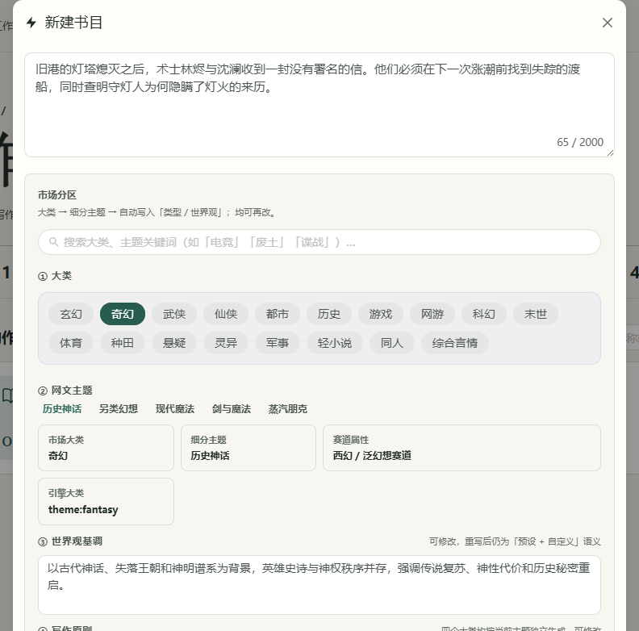

### 3. 设置篇幅并建档

直接选择一个 **「目标篇幅」** 档位，系统会推导目标章数和每章字数。要指定书名或自己设置篇幅，展开 **「高级（自定义章数/每章字数）」**，填写「书名」「章节数」「每章字数」。书名留空时会从梗概开头截取。点击 **「建档并进入工作台」**，作品建立后会弹出新书设置向导。

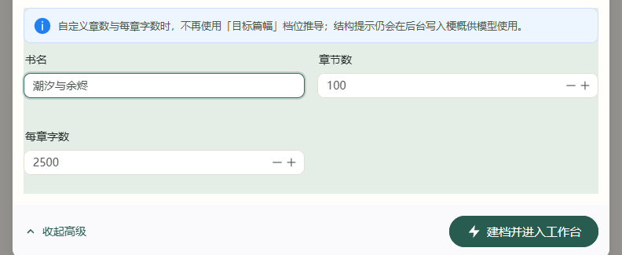

### 4. 设置模型并走完新书向导

建档本身可以离线完成。向导的 **「开始生成」** 需要启用聊天模型。如果还没配置，可以关闭向导，在作品库左侧打开 **「AI 控制台」**，新建或导入模型档案，填写 OpenAI 兼容的 Base URL、模型名和 API Key，测试连接后设为启用。然后回到作品库点击 **「继续创作」**，继续新书设置。密钥在应用中填写。调用模型时，所选服务会收到完成这次任务所需的上下文。[模型配置详解](project_docs/DEEPSEEK_SETUP.md)

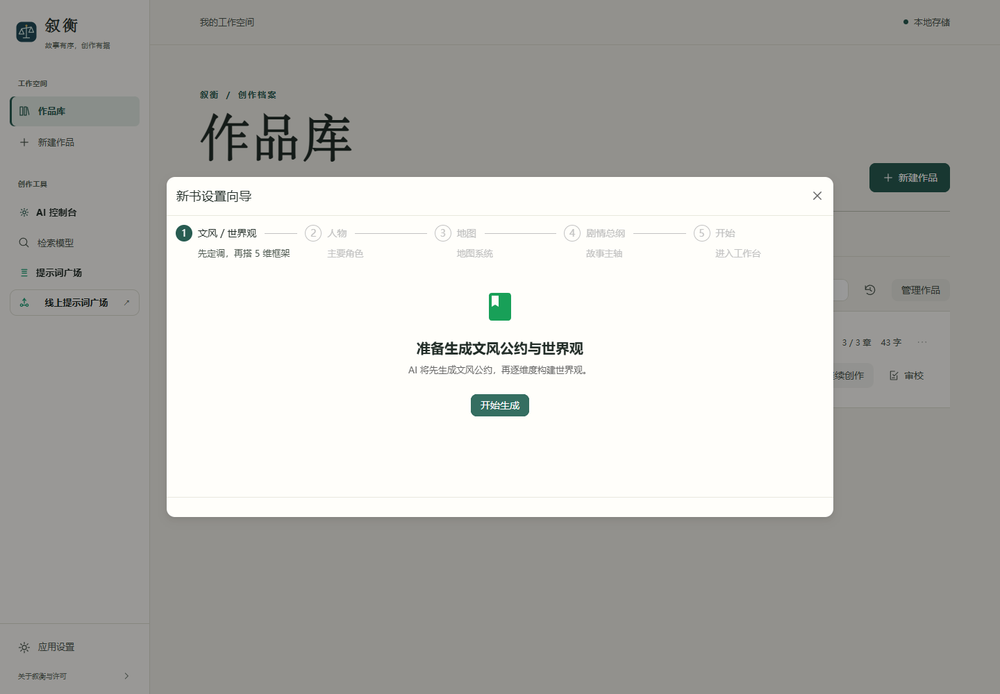

按「文风 / 世界观 → 人物 → 地图 → 剧情总纲」依次生成。每一步都有可编辑的预览，核对或修改后点 **「确认修改并继续」**。进入后续步骤后可选择 **「跳过向导」**，已保存的内容会保留。完成时点 **「进入工作台」**。剧情总纲描述全书走向，具体章节由下一步的章节规划或托管流程建立。

## 写作与规划

1. **建立第一章。** 如果已有「幕」节点，在左侧树形目录右键该幕，选 **「添加章节（手动）」** 或 **「AI 规划章节」**。如果是空白新书，可切到 **「托管撰稿 → 启动全托管」**，让模型先做宏观结构与幕规划，保留人工确认并设置保护上限。想先不配置模型，可用启动时添加的示例书练习编辑已有章节。
2. **写作和保存。** 左侧选章节，在中央 **「章节编辑」** 输入或粘贴正文，点击标题右侧 **「保存」**。切换章节前先保存。右侧可同时打开作品设定或写作资料。
3. **按章使用 AI。** 有目标章节后，可用编辑区下方的 **「快速生成」** 按大纲起稿，查看生成内容后选择 **「保存到所选章节」**。**「重新生成」** 会先为旧稿保留历史快照，仍需核对生成结果。**「张力诊断」** 可辅助找出当前章节的张力缺口，生成和诊断均使用已配置的模型。
4. **查看本章信息。** **「本章舞台」** 查看章节要素，**「任务与状态」** 查看本章规划和运行状态。顶部 **「一致性审校 ↗」** 在独立页面打开当前章节的审校。

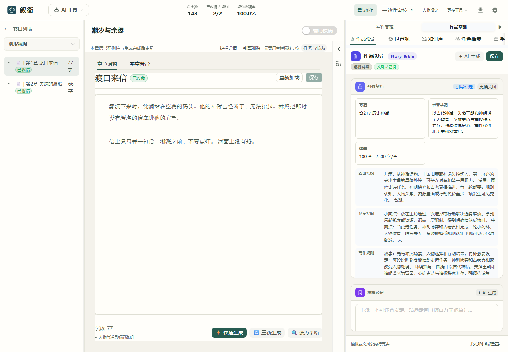

## 设定与写作资料

### 人物、关系与世界观

- **作品设定。** 点击工作台上方 **「人物设定」**，右侧打开 **「作品设定」**。这里可维护作品梗概、创作约束和文风公约，修改后点「保存」，供后续规划和生成读取。
- **人物档案。** 从 **「更多工具 → 角色档案」** 查看角色资料。首次建书可在向导的「人物」步骤生成并编辑主要角色及关系。审校要用到的限制，在审校页另有明确的设置和保存步骤。
- **世界观。** 从 **「更多工具 → 世界观」** 打开维度表单，按作品补充核心规则、地理等设定。例如写清水系术士的能力与代价，再点「保存」。章节中出现例外时，可以回到这里核对背景。
- **知识库和图谱。** **「更多工具 → 知识库」** 可维护分章叙事和事实。人物关系用「主体 → 关系 → 对象」记录，例如「沈澜 → 信任 → 林烬」；从「人物关系图」查看连接，从「地点关系图」看地点之间的联系。图谱需要相应的已保存数据。

<details>
<summary>查看世界观面板</summary>

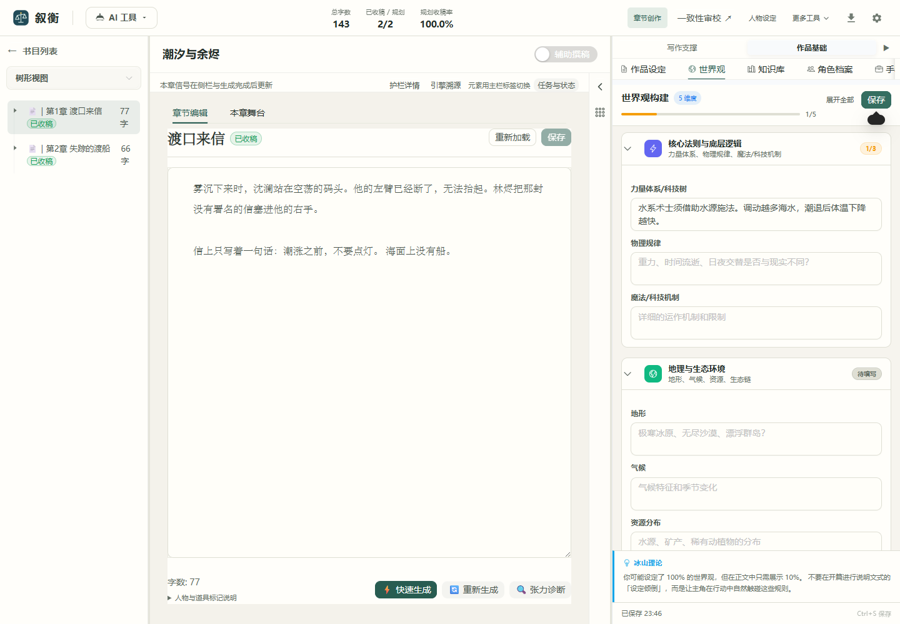

</details>

### 伏笔与故事演进

从 **「更多工具 → 伏笔账本」** 点 **「+ 添加」**，记录读者当前的疑问、关联角色、埋入章和可选的预计兑现章。例如把「来信为什么要求在涨潮前熄灯？」登记在第 1 章，兑现后标记已消费。用 **「故事演进」** 回看阶段记录，用 **「写作支撑 → 当前语境」** 对照当前章节可用的资料。

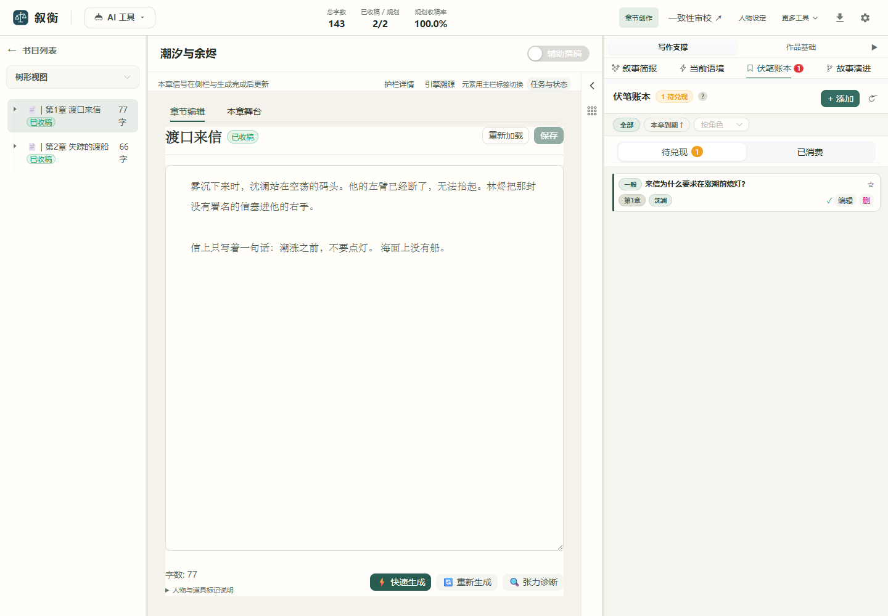

### 道具与提示词

- **手稿道具。** 在右侧 **「作品基础 → 手稿道具」** 查看正文中的道具及事件记录。点开具体道具可查看历次状态，也可手动补记事件。例如在第 1 章登记谁收到了无名信，在第 3 章核对信是否已经转手。
- **提示词广场。** 从作品库左侧 **「提示词广场」** 查看各阶段的提示词。可针对人物生成、章节正文或审校调整要求，让模型在相应阶段遵循你的偏好。原文和写作规则可先在作品内维护，提示词适合调整某一类 AI 任务的输出方式。

## 一致性审校

保存正文后，从作品库点击作品的 **「审校」** 打开最新一章，或从工作台的 **「一致性审校 ↗」** 审校选中的章节。

### 规则审校与原文核对

1. 打开 **「审校设置」**，手动添加人物规则，或点 **「从作品人物库导入草稿」**。检查人物名、别名、事实、仅能使用的元素能力和禁止行为，点 **「保存人物设定」**。
2. 点 **「规则审校」**。点击一条结果，左栏高亮命中的原句，右栏展示设定依据。下图中，沈澜的规则写明只能使用水系，正文却写他释放了火球。
3. 结合情节点 **「确认问题」** 或 **「忽略此项」**，也可 **「撤销处理」**。在 **「运行历史」** 查看各次结果，点 **「导出报告」** 下载 JSON。正文或依据有变化时，重新运行审校。

本地规则无需 API Key，适合检查写得明确的限制。要快速体验，可以在内置示例第 2 章直接运行规则审校并点击「沈澜释放火球」。


### 历史检索、人物事实与 AI 审校

- **历史检索。** 在第 2 章切到 **「历史检索」**，输入「沈澜 左臂」，点击 **「检索历史正文」**。结果会标注同一作品的前序章节和原文片段，可跳到来源核对。长篇可先点 **「构建索引」**；关键词检索无需密钥。
- **语义检索。** 在作品库左侧 **「检索模型」** 配置 Embedding 和可选的 Reranker。回到历史检索点 **「构建向量索引」**，可结合关键词和语义匹配，按配置重排候选。构建会向嵌入服务发送正文片段，可能计费。
- **人物事实。** 打开 **「人物事实」** 查看章后提取的候选。点开候选比对来源原句、已有设定和适用章段，再选择接受、拒绝或保留并存。可撤销决定；来源改写或删除时，界面会提示依据失效。
- **AI 深度审校。** 启用聊天模型后，点 **「AI 深度审校」**，结合已保存正文、人物设定和可检索的历史片段寻找疑点。检查结果中的引用和待复核项；引用校验失败时会有提示。任务进度、取消和重新发起可在 **「任务与用量」** 中查看。

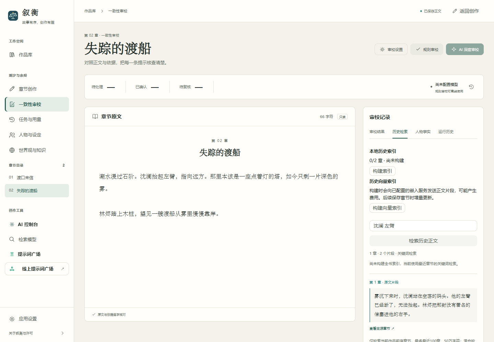

## 托管与用量

### 全托管撰稿

在章节工作台切换到 **「托管撰稿」**，点 **「启动全托管」**。设置全书目标章数、每章目标字数和**累计托管章节数保护上限**。例如已经托管写完 1 章，保护上限填 2，则再写 1 章后停止。

首次试写可关闭 **「全自动模式」**。宏观结构、幕级规划等需要审阅的阶段会暂停，检查后点 **「再次确认 · 继续」**。进度在托管面板查看，运行中可点 **「停止」**；停止后再回编辑区改正文。遇到保存中断，去 **「任务与用量 → 托管章节检查点」** 核对状态。若提供 **「取回生成稿」**，先下载稿件并核对数据库里的章节，再回工作台恢复。

<details>
<summary>查看托管启动参数</summary>

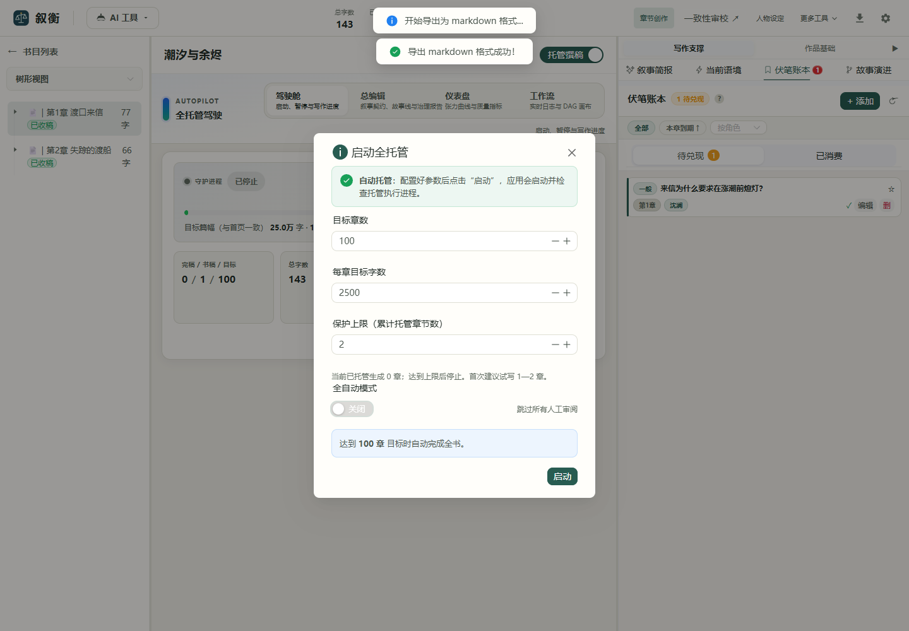

</details>

### 审校任务、章后处理与预算

从工作台 **「更多工具 → 任务与用量」**，或审校页左侧进入。

- 在 **「审校任务」** 看运行阶段及失败原因。取消请求后的在途模型调用仍可能计费，重新发起前会提示确认。
- 在 **「章后处理任务」** 看正文保存后的叙事和知识同步。恢复可复用已留存的模型结果；遇到未知用量，先对照服务商账单，再确认是否重试缺失结果的步骤。
- 点 **「设置作品预算」**，可按作品设置累计与每日请求数、Token 或估算费用上限，并选择统计时区。金额依赖自填模型单价；费用估算和实际账单可在 **「模型请求明细」** 对照。

<details>
<summary>查看作品预算设置</summary>

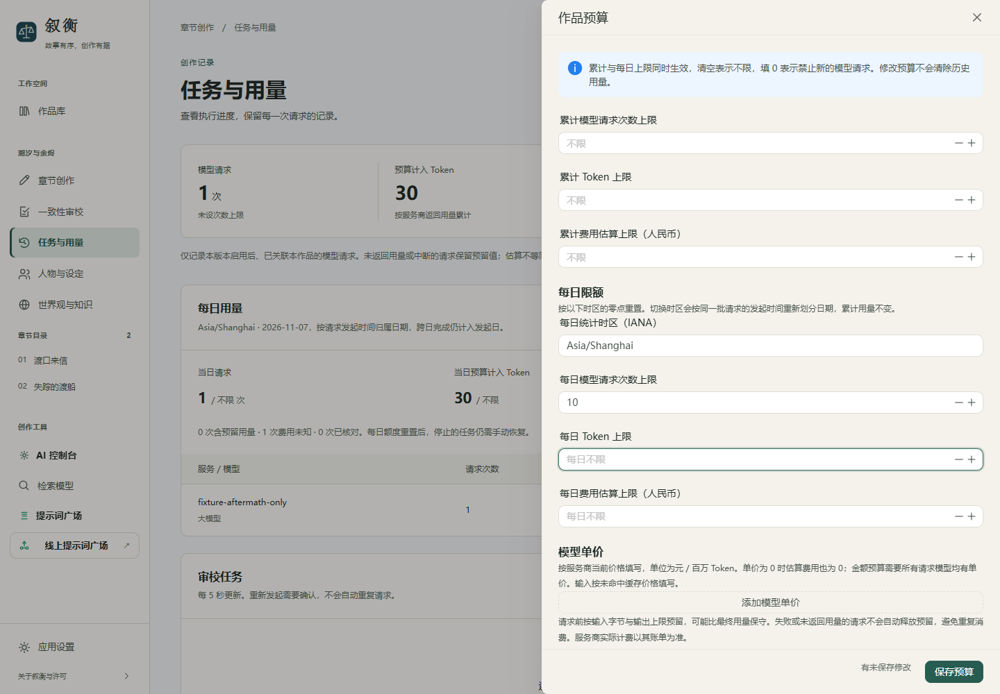

</details>

## 备份与导出

- **导出文稿。** 在章节工作台右上角点下载图标 **「导出」**，选择 EPUB、PDF、DOCX 或 Markdown。它用于分享和编辑文稿。审校记录需要在审校页另行导出 JSON。
- **创建联合备份。** 打开 **「任务与用量 → 数据备份 → 创建联合备份」**，保存作品、章节、设定和运行账本。创建后可校验、下载，也可用 **「校验本地备份」** 检查已有 ZIP。备份可能包含数据库中的模型配置与密钥，请保存在可信位置。
- **恢复数据。** 校验备份后关闭本地服务和托管进程，运行 `restore-xuheng.cmd`，核对预览并按提示确认。恢复会覆盖本机所有作品，脚本会先创建安全副本；重新启动后核对正文与账目。

<details>
<summary>查看文稿导出和联合备份入口</summary>

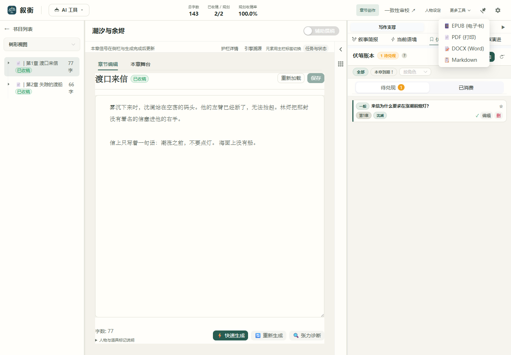

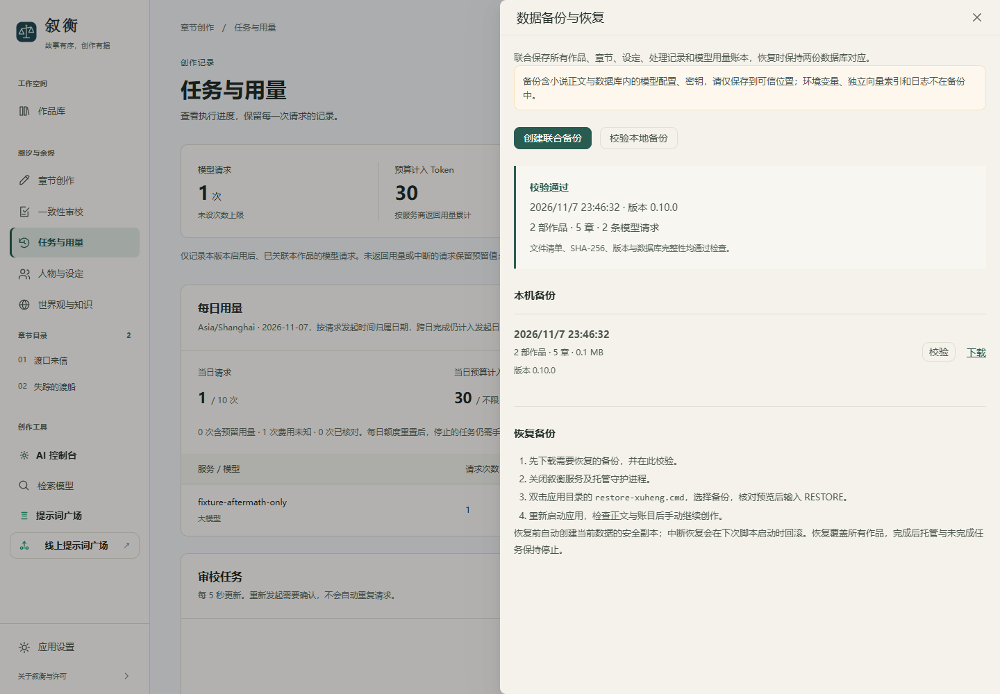

</details>

## 项目文档

- [运行、配置与故障处理](project_docs/GETTING_STARTED.md)
- [架构与 API](project_docs/ARCHITECTURE.md)
- [0.10.0 交付记录](project_docs/RELEASE_0.10.md)
- [开发进度与待验收项](project_docs/ROADMAP.md)
- [验证记录与已验证范围](project_docs/VALIDATION.md)
- [二次开发内容与上游来源](project_docs/CONTRIBUTIONS.md)

本页截图来自本地浏览器中的虚构示例。浏览器走查验证了建档、编辑和重读正文、保存世界观和伏笔、关键词检索、保存预算、Markdown 下载及备份校验。演示用模拟响应进入向导下一步，并预置两章用于后续操作。托管截图展示启动前的配置。

## 许可

叙衡基于 PlotPilot 二次开发。适用 **Apache 2.0 + Commons Clause**，完整条款及来源见 [LICENSE](LICENSE) 和 [NOTICE.md](NOTICE.md)。
