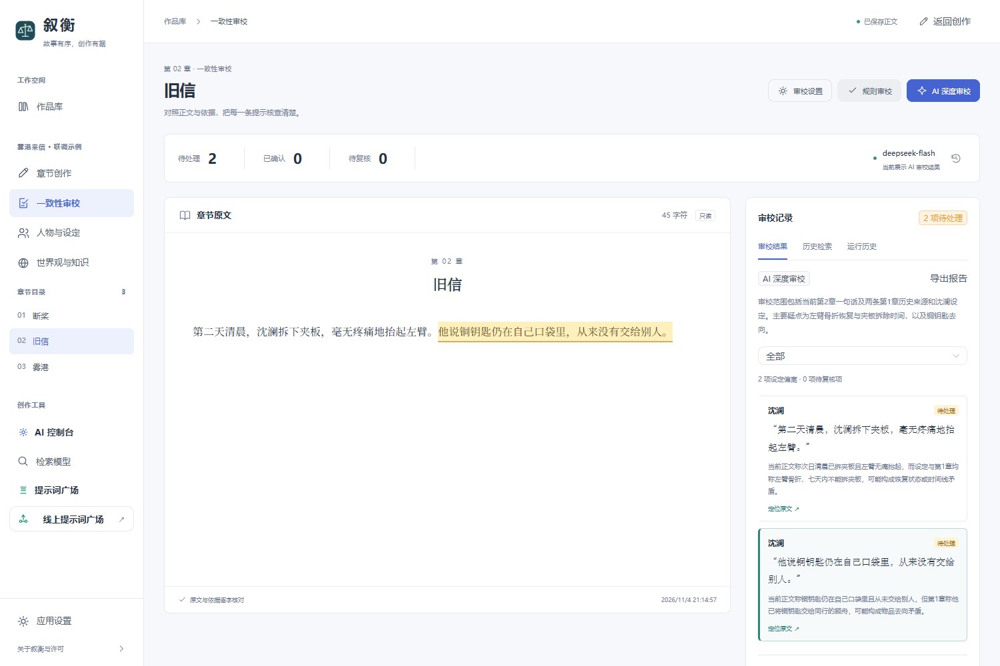

# 叙衡 Xuheng

面向长篇小说的 AI 创作与一致性审校工作台。管理作品、整理人物与世界观，检索历史章节，对照原文与依据核查疑似矛盾。

当前版本：**0.4.0 · 本机浏览器版**。技术栈：Python、FastAPI、SQLite、Vue 3、TypeScript。



## 功能

| 模块 | 能做什么 |
| --- | --- |
| 作品库 | 新建、搜索、管理作品，查看章节及字数，进入创作或审校 |
| 章节创作 | 编辑与保存正文、辅助生成、按章节范围托管连写、查看生成进度 |
| 人物与世界观 | 管理人物档案、作品设定、世界观、知识库和人物/地点关系图 |
| 写作辅助 | 伏笔账本、故事演进、提示词管理，以及张力、文风等分析入口 |
| 一致性审校 | 本地规则检查与 AI 深度审校，对照人物事实和历史正文识别疑似矛盾 |
| 历史检索 | BM25、关键词与向量混合召回、RRF 合并、Reranker 排序及向量缓存 |
| 证据核对 | 原文精确高亮、设定/前章引用、无效引用警告，正文或依据变化后标记过期 |
| 人工处理 | 确认、忽略、撤销处理，保留反馈与运行历史，导出 JSON 审校报告 |
| 模型控制 | OpenAI 兼容聊天档案、Embedding / Reranker 配置、连接测试与实际用量记录 |
| 文稿导出 | EPUB、PDF、DOCX、Markdown |

## 运行

已验证环境：Windows、Python 3.13、Node.js 24。

```powershell
python -m venv .venv
.\.venv\Scripts\python.exe -m pip install -r requirements.txt -c requirements-tested.txt
cd frontend
npm ci
npm run build
cd ..
.\start-xuheng.ps1 -Demo
```

打开 [本地作品库](http://127.0.0.1:8005/)。准备好依赖后也可双击 `start-xuheng.cmd`，服务就绪后自动打开浏览器。

本地规则和关键词检索无需 API Key。聊天模型在左侧“AI 控制台”配置；Embedding 与 Reranker 在“检索模型”配置。密钥只在本机填写，个人数据、日志和模型凭据不随源码提交。

## 验证与范围

- 本地单元测试：1636 项通过，7 项跳过；7 项浏览器端到端场景通过。
- 已真实联调 DeepSeek 审校、硅基流动 Embedding / Reranker，以及一次受控单章托管请求。
- 已修复全托管未启动执行进程却显示运行的问题，在实际作品上验证宏观规划、首幕规划、首章保存、章后流程及保护章数自动停止。早期审校联调使用虚构示例；这些检查只说明对应集成链路可用，长期托管稳定性、真实长篇质量和生产并发仍需专项验证。
- 历史检索当前限定同作品前置章节，最多最近 100 章、50 万字符。
- 当前没有独立原生安装包或公网多用户服务。

## 文档

- [快速运行与使用](project_docs/GETTING_STARTED.md)
- [0.4.0 交付记录](project_docs/RELEASE_0.4.md)
- [架构与 API](project_docs/ARCHITECTURE.md)
- [验证记录](project_docs/VALIDATION.md)
- [后续完善清单](project_docs/ROADMAP.md)
- [模块与来源](project_docs/CONTRIBUTIONS.md)

## 许可

适用 **Apache 2.0 + Commons Clause**，完整条款见 [LICENSE](LICENSE)，代码来源与版权说明见 [NOTICE.md](NOTICE.md)。
