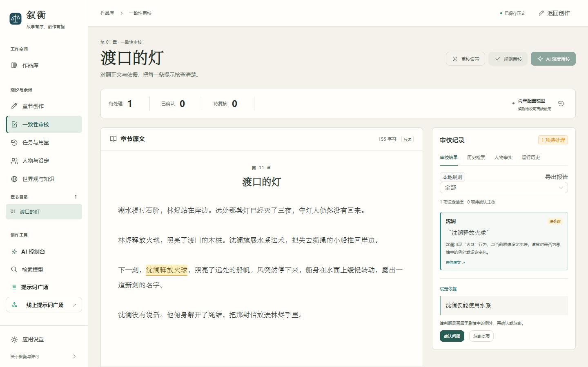
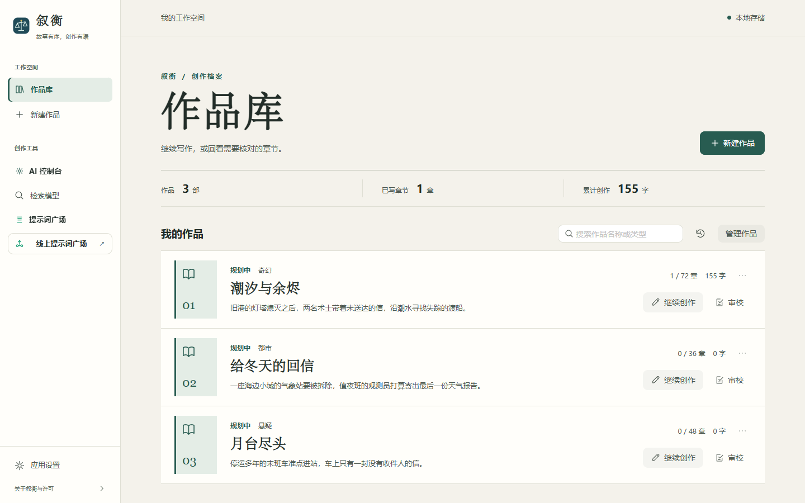
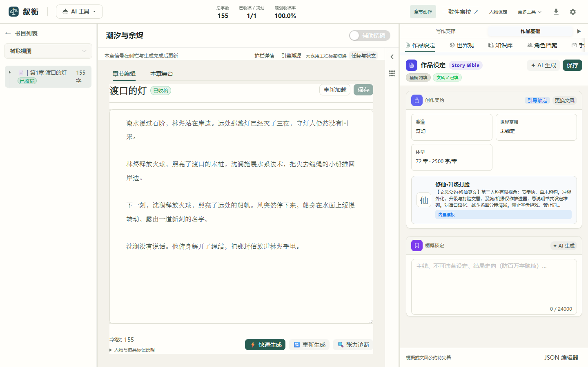

# 叙衡 Xuheng

**为长篇小说作者打造的本地 AI 写作与一致性审校工作台。**

在同一个作品里写章节、管理人物设定，并对照原文检查前后矛盾。下图中，只会水系法术的角色释放了火球，叙衡标出对应原句和设定依据，由作者判断是否需要修改。

[快速运行](#快速运行) · [五分钟体验](#五分钟体验) · [架构与 API](project_docs/ARCHITECTURE.md) · [开发进度](project_docs/ROADMAP.md)



*示例作品《潮汐与余烬》的规则审校结果。*

## 创作流程

| 阶段 | 能做什么 |
| --- | --- |
| 整理作品 | 在作品库搜索和管理长篇稿件，查看章数和字数，直接进入创作或审校。 |
| 写作与设定 | 编辑章节，维护人物、世界观、知识库、关系图和伏笔。配置模型后可辅助生成，或按章节范围托管撰稿。 |
| 检索与审校 | 用本地规则检查显式设定。AI 深度审校可检索同一作品的前序章节，使用关键词与向量混合召回，并按配置启用重排。 |
| 核对与处理 | 查看原文高亮和引用，确认、忽略或撤销问题，审阅正文提取的人物事实，并导出 JSON 审校报告。 |
| 管理本地数据 | 查看模型任务和用量，设置预算，恢复中断的托管任务，备份作品与运行记录，导出 EPUB、PDF、DOCX 或 Markdown。 |

<details>
<summary>查看作品库和章节编辑截图</summary>





</details>

## 快速运行

当前交付为 **0.10.0 本机浏览器版**，已验证 Windows、Python 3.13 和 Node.js 24。前端使用 Vue 3 与 TypeScript，后端使用 FastAPI 与 SQLite。

克隆仓库后，在项目根目录执行。

```powershell
python -m venv .venv
.\.venv\Scripts\python.exe -m pip install -r requirements.txt -c requirements-tested.txt
cd frontend
npm ci
npm run build
cd ..
.\start-xuheng.ps1 -Demo
```

服务启动后访问 [本地作品库](http://127.0.0.1:8005/)。依赖准备好后，也可以双击 `start-xuheng.cmd` 打开应用。

本地规则审校和关键词检索无需 API Key。AI 深度审校使用「AI 控制台」中启用的 OpenAI 兼容模型，向量检索与重排可在「检索模型」中单独配置。作品、运行记录和凭据存储在本机，模型请求会把本次任务所需的上下文发给所配置的服务。

## 五分钟体验

1. 在作品库找到《潮汐与余烬 · 审校示例》，点击「审校」。
2. 运行「规则审校」，点开「沈澜释放火球」，查看原文高亮和人物设定引用。
3. 试着忽略并撤销这条问题，再切换到「运行历史」查看记录，或导出审校报告。

## 项目文档

- [启动、示例与模型配置](project_docs/GETTING_STARTED.md)
- [0.10.0 交付记录](project_docs/RELEASE_0.10.md)
- [验证记录与已验证范围](project_docs/VALIDATION.md)
- [开发进度与待验收项](project_docs/ROADMAP.md)
- [二次开发内容与上游来源](project_docs/CONTRIBUTIONS.md)

## 许可

叙衡基于 PlotPilot 二次开发。适用 **Apache 2.0 + Commons Clause**，完整条款及来源见 [LICENSE](LICENSE) 和 [NOTICE.md](NOTICE.md)。
