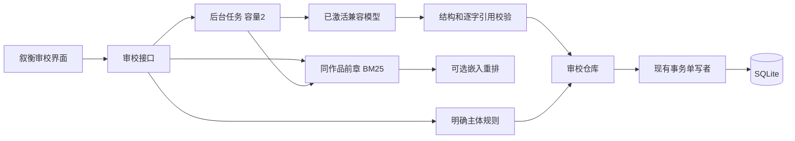

# 审校扩展架构

扩展接入现有 FastAPI / Vue / SQLite 工作台。创作引擎、基础 RAG、知识图谱、单写者队列与桌面壳来自上游。

## 模块

| 路径 | 职责 |
| --- | --- |
| `domain/novel/services/action_attribution.py` | 有限中文句式的主体与动作归属，保留位置，不可靠判断进入待确认 |
| `application/audit/evidence_models.py` | 规则、请求、输入及版本约束 |
| `application/audit/services/evidence_review_service.py` | 离线检查、缓存、失效与反馈 |
| `application/audit/services/history_retrieval.py` | 历史正文分块、BM25、可选重排与缓存 |
| `application/audit/services/ai_evidence_review.py` | 提示编排、结构与引用验证、运行落盘 |
| `application/audit/services/review_jobs.py` | 有界线程任务、活动去重、进度与取消 |
| `infrastructure/ai/evidence_model_client.py` | 兼容 Chat Completions、输出预算、用量与错误脱敏 |
| `infrastructure/persistence/database/evidence_review_store.py` | 关系数据、快照、索引、反馈、写入确认 |
| `interfaces/api/v1/audit/evidence_review_routes.py` | 审校、检索、模型状态、任务、历史、导出 API |
| `frontend/src/views/EvidenceReview.vue` | 核对、检索、轮询、原文高亮、反馈与导出 |

## 检索与模型

历史只使用同作品且章节号小于目标章的正文，最多最近 100 章、总计 50 万字符、单章 10 万字符。正文块最多 700 字符，重叠 80；中文 bigram BM25 最多返回 6 块，每章最多 2 块。

可选语义模式对最多 24 个词法候选调用现有嵌入服务重排，以非密钥配置指纹和文本哈希缓存向量。这是 BM25 加重排，不是全量向量召回。未配置或失败会明确报错。保存完整来源哈希与精确位置，不将摘要当作正文证据。

模型最多接收 2 万字符目标正文与有界历史块。输出默认 4096，可选 2048 / 8192 Token，只用已激活档案，不自动替换模型或重试。DeepSeek 官方端点默认关闭思考，显式高级参数优先。

本地 Pydantic 校验结构，核对人物、来源 ID、两端逐字引用和重复片段序号。无效候选排除并警告，整体 JSON 不合法则任务失败。格式和引用有效仍不能保证语义正确。用量只记录服务商实际值，缺失时为未知。

## 证据、版本和事务

原文范围为 Unicode code point 的 `[start,end)`；前端用 `Array.from` 处理 emoji 与 UTF-16 差异，高亮前再次核对。保存不可变来源快照及正文、规则、历史上下文哈希，章节 ID、编号、引擎版本和模型信息。历史章节新增、修改或重排会使上下文变化；长作品仍受检索上限限制。

确定性规则结果可复用，AI 手动运行形成独立记录，不宣称随机输出幂等。反馈通过版本号与唯一 token 条件更新，SQL 同时核对当前正文、规则、编号和历史引用，阻止旧标签页覆盖新判断。

写入复用 `DatabaseConnection.transaction()` 和单写者队列，读回本次运行或版本 token 后才确认，最多等待 4 秒，未确认返回 503。迟到写入仍可能完成，客户端需刷新。新增表包括 `xh_rule_*`、`xh_review_*`、`xh_feedback_events`、`xh_history_*` 和 `xh_embedding_cache`；向量数组是技术索引 JSON。

任务容量为 2，同章活动请求复用，内存最多保留 80 条任务。页面刷新恢复活动进度及最近结果；完成结果落盘，在途线程任务重启不恢复。取消在调用前后检查，不能承诺中止已被服务商接收的付费请求。没有引入 Celery / Redis 或多租户身份体系，按本机工具交付。

## API

统一前缀 `/api/v1/evidence-reviews`：

| 方法 | 路径 | 含义 |
| --- | --- | --- |
| GET / PUT | `/{novel}/rules` | 限制配置，保存带 revision |
| POST | `/{novel}/chapters/{number}` | 离线检查已保存正文 |
| GET | `/{novel}/chapters/{number}/latest?mode=rules或ai` | 最近结果和失效状态 |
| POST | `/{novel}/chapters/{number}/context` | 历史检索 |
| POST | `/{novel}/chapters/{number}/ai` | 202，后台审校 |
| GET | `/{novel}/chapters/{number}/active-job` | 活动任务 |
| GET | `/{novel}/jobs/{job}` | 任务进度 |
| POST | `/{novel}/jobs/{job}/cancel` | 请求取消 |
| GET | `/{novel}/chapters/{number}/runs` | 最近 20 条运行 |
| GET | `/{novel}/runs/{run}` | 作品范围内结果 |
| GET | `/{novel}/runs/{run}/export` | JSON 下载 |
| PATCH | `/{novel}/runs/{run}/issues/{issue}` | 状态与 expected_version |
| GET | `/model/status` | 非密钥状态 |

404 为作品边界内未找到，409 为输入或反馈冲突，422 为不支持输入，503 为不可用或写入未确认。
