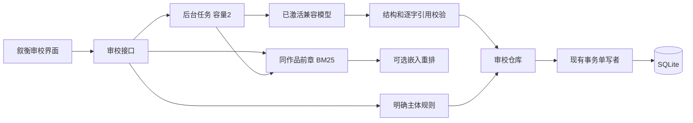

# 审校扩展架构

扩展接入现有 FastAPI / Vue / SQLite 工作台。创作引擎、基础 RAG、知识图谱、单写者队列与桌面壳来自上游。

## 模块

| 路径 | 职责 |
| --- | --- |
| `domain/novel/services/action_attribution.py` | 有限中文句式的主体与动作归属，保留位置，不可靠判断进入待确认 |
| `application/audit/evidence_models.py` | 规则、请求、输入及版本约束 |
| `application/audit/services/evidence_review_service.py` | 离线检查、缓存、失效与反馈 |
| `application/audit/services/history_retrieval.py` | 历史正文分块、BM25、可选重排与缓存 |
| `application/audit/services/ai_evidence_review.py` | 提示编排、结构与引用验证、运行落盘 |
| `application/audit/services/review_jobs.py` | 有界线程任务、活动去重、进度与取消 |
| `infrastructure/ai/evidence_model_client.py` | 兼容 Chat Completions、输出预算、用量与错误脱敏 |
| `infrastructure/persistence/database/evidence_review_store.py` | 关系数据、快照、索引、反馈、写入确认 |
| `infrastructure/persistence/operation_journal.py` | 独立运行账本、原子预留、累计及按日预算检查 |
| `infrastructure/persistence/usage_ledger.py` | IANA 时区日期边界、模型汇总、追加式账单核对与差额 |
| `infrastructure/persistence/database/aftermath_task_store.py` | 主库中的章后任务、心跳、模型请求结果和恢复决定 |
| `application/engine/services/durable_aftermath.py` | 正文版本校验、阶段复用、辅助队列恢复及写入完成标记 |
| `application/ai/durable_calls.py` | 按业务调用角色缓存分析结果；未确认请求禁止自动重发 |
| `interfaces/api/v1/audit/evidence_review_routes.py` | 审校、检索、模型状态、任务、历史、导出 API |
| `frontend/src/views/EvidenceReview.vue` | 核对、检索、轮询、原文高亮、反馈与导出 |

## 检索与模型

历史只使用同作品且章节号小于目标章的正文，最多最近 100 章、总计 50 万字符、单章 10 万字符。正文块最多 700 字符，重叠 80；中文 bigram BM25 最多返回 6 块，每章最多 2 块。

可选语义模式对最多 24 个词法候选调用现有嵌入服务重排，以非密钥配置指纹和文本哈希缓存向量。这是 BM25 加重排，不是全量向量召回。未配置或失败会明确报错。保存完整来源哈希与精确位置，不将摘要当作正文证据。

模型最多接收 2 万字符目标正文与有界历史块。输出默认 4096，可选 2048 / 8192 Token，只用已激活档案，不自动替换模型或重试。DeepSeek 官方端点默认关闭思考，显式高级参数优先。

本地 Pydantic 校验结构，核对人物、来源 ID、两端逐字引用和重复片段序号。无效候选排除并警告，整体 JSON 不合法则任务失败。格式和引用有效仍不能保证语义正确。用量只记录服务商实际值，缺失时为未知。

## 证据、版本和事务

原文范围为 Unicode code point 的 `[start,end)`；前端用 `Array.from` 处理 emoji 与 UTF-16 差异，高亮前再次核对。保存不可变来源快照及正文、规则、历史上下文哈希，章节 ID、编号、引擎版本和模型信息。历史章节新增、修改或重排会使上下文变化；长作品仍受检索上限限制。

确定性规则结果可复用，AI 手动运行形成独立记录，不宣称随机输出幂等。反馈通过版本号与唯一 token 条件更新，SQL 同时核对当前正文、规则、编号和历史引用，阻止旧标签页覆盖新判断。

写入复用 `DatabaseConnection.transaction()` 和单写者队列，读回本次运行或版本 token 后才确认，最多等待 4 秒，未确认返回 503。迟到写入仍可能完成，客户端需刷新。新增表包括 `xh_rule_*`、`xh_review_*`、`xh_feedback_events`、`xh_history_*` 和 `xh_embedding_cache`；向量数组是技术索引 JSON。

任务容量为 2，同章活动请求复用，记录在独立运行库持久化。页面刷新恢复进度及最近结果；重启将未完成任务标记中断，已保存结果可恢复关联，不自动重复请求模型。取消不能承诺免除服务商已接收请求的费用。没有引入 Celery / Redis 或多租户身份体系，按本机工具交付。

## API

统一前缀 `/api/v1/evidence-reviews`：

| 方法 | 路径 | 含义 |
| --- | --- | --- |
| GET / PUT | `/{novel}/rules` | 限制配置，保存带 revision |
| POST | `/{novel}/chapters/{number}` | 离线检查已保存正文 |
| GET | `/{novel}/chapters/{number}/latest?mode=rules或ai` | 最近结果和失效状态 |
| POST | `/{novel}/chapters/{number}/context` | 历史检索 |
| POST | `/{novel}/chapters/{number}/ai` | 202，后台审校 |
| GET | `/{novel}/chapters/{number}/active-job` | 活动任务 |
| GET | `/{novel}/jobs/{job}` | 任务进度 |
| POST | `/{novel}/jobs/{job}/cancel` | 请求取消 |
| GET | `/{novel}/chapters/{number}/runs` | 最近 20 条运行 |
| GET | `/{novel}/runs/{run}` | 作品范围内结果 |
| GET | `/{novel}/runs/{run}/export` | JSON 下载 |
| PATCH | `/{novel}/runs/{run}/issues/{issue}` | 状态与 expected_version |
| GET | `/model/status` | 非密钥状态 |
| GET | `/{novel}/operations?day=YYYY-MM-DD&offset=0&uncertain_only=false` | 累计及每日统计、按模型汇总、请求分页；省略日期取所选时区今天 |
| PUT | `/{novel}/operations/policy` | 累计/每日限额、IANA 时区及模型单价 |
| GET | `/{novel}/operations/calls/{call}/reconciliations` | 作品范围内请求的全部核对历史 |
| POST | `/{novel}/operations/calls/{call}/reconciliations` | 按 request_key 幂等追加核对，expected_revision 防止覆盖新版本 |
| POST | `/{novel}/operations/aftermath/{task}/resume` | 正文校验后排队恢复；未知请求须确认并填写说明，可明确请求未写入阶段的新模型结果 |

404 为作品边界内未找到，409 为输入或反馈冲突，422 为不支持输入，503 为不可用或写入未确认。

运行记录库通过 `usage_calls` 视图合并原请求与最新核对；`calls` 保留原请求，`call_adjustments` 追加前后快照、依据和差额。累计、每日与模型汇总、请求前检查均读取同一有效视图。预留和核对使用 `BEGIN IMMEDIATE`，统计使用同一读事务。未知金额与用量不转成零；核对可明确填写零值。每日窗口以 IANA 时区的相邻两个本地零点换算 UTC，覆盖夏令时；请求以发起日归属，日限额拦截附有到期时间，不自动恢复任务。当前为单个本地 API 进程；本轮只串行化本进程的账本初始化，不提供多执行进程任务协调。

章后任务使用主库的 `xh_aftermath_tasks/steps/requests/resumes`，以作品、章节、正文哈希去重。图谱、伏笔、债务、道具、辅助快照等标记的本地步骤，使用独立短事务与完成标记共同提交；仓储在该上下文内加入同一连接，嵌套提交不提前结束事务，写 SQL 失败即使被旧代码捕获也会回滚。该上下文禁止模型/检索请求，不持写事务等待网络。普通正文写队列的调用方式保持原有行为。

分析模型结果在返回业务解析前留存；缓存按业务调用角色区分，避免恢复时可选分支变化拿错结果。失去心跳后，有未确认请求的任务进入等待确认，其余可继续排队；完成阶段和本地步骤均复用。API 启动扫描负责恢复辅助尾部，旧纯内存队列只保留作无真实数据库依赖的兼容路径。没有实现跨库全局事务或所有调度器的多进程协调；F15 单独验收。联合备份见下文。

## 联合备份与离线恢复（0.10）

`/api/v1/maintenance/backups` 提供 GET 列表、POST 创建；`/{id}/export` 下载，`/{id}/verify` 校验；`/inspect` 接收 multipart 文件，仅校验不覆盖。列表与校验返回日期、版本、计数和文件校验信息，不返回正文或密钥。下载的私人 ZIP 则包含数据库内凭据。

`BackupService` 在 ATTACH 的两库上持写锁，分别用 SQLite backup API 读取已提交快照；固定清单校验文件、版本、SHA-256、数据库完整性及计数。应用持共享运行锁，离线恢复取独占锁；覆盖前保存安全备份并持久化恢复日志。启动脚本调用 CLI recover，未完成替换一律回滚旧数据，直接数据库初始化拒绝打开待恢复目录。

恢复会停止托管、隔离待执行任务、保留未知费用预留，并刷新主库内索引代次。本地运行时向量使用独立的新目录，旧 Qdrant 索引暂停使用。审校历史索引由作品 API `/novels/{id}/index` 管理，关键词倒排、向量缓存与批次领取记录保存在主库。远端向量请求在事务外执行，回写时核对任务领取及当前正文。恢复会清理两类历史索引并暂停构建。
