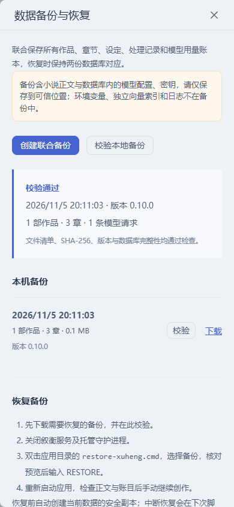

# 叙衡 0.10.0 · 联合备份与恢复

日期：2026-11-05。本批优先完成 P0：先交付 [F02 章后任务恢复与幂等](RELEASE_0.9.md)，再完成 F03 两库联合备份与恢复。



## 使用入口

“工作台 → 更多工具 → 任务与用量 → 数据备份”：创建、下载、校验本机备份，或选择 ZIP 检查完整性。备份针对全部作品，包含主库和同名 `.operations.sqlite3` 账本。

恢复时关闭应用服务和托管守护进程，双击应用目录 `restore-xuheng.cmd`，选择备份、核对版本和作品/章节数量，然后输入 `RESTORE`。替换前自动创建当前数据的安全副本。也可使用以下 CLI：

```powershell
.\.venv\Scripts\python.exe scripts/manage_backups.py create
.\.venv\Scripts\python.exe scripts/manage_backups.py inspect C:\backups\xuheng-example.zip
# 默认预览；只有 --apply 才替换全部作品和账本，且应用必须关闭。
.\.venv\Scripts\python.exe scripts/manage_backups.py restore C:\backups\xuheng-example.zip --apply
```

## 实现与边界

- 使用同一连接 ATTACH 两个库并持有写锁，阻止 API 与守护进程在两份快照之间写入；独立只读连接通过 SQLite backup API 保存已提交的 WAL 数据。这是同一时间边界的两库快照，不是把业务写入改成跨库全局事务。
- ZIP 固定为清单与两份数据库，记录版本、字节数、SHA-256 和作品/章节/调用数量。校验包括数据库完整性、必要表、文件清单和版本范围。拒绝重复/多余文件、目录穿越、符号链接、加密和超限文件。
- 格式版本为 1；接受浏览器版 0.6.0 至当前版本的联合备份。未来版本、无效版本与旧格式拒绝；数据库迁移仍由应用初始化处理。单库上限 256 MB，上传总大小受限。
- 应用与守护进程持共享运行锁，离线恢复须取得独占锁；备份/恢复同时只能有一个维护操作。Windows 使用 LockFileEx，退出或进程被杀后由系统释放锁。
- 完整校验后创建安全副本，暂存待恢复文件，先持久化恢复日志，再逐个原子替换。进程若在替换两库之间退出，启动脚本先从安全副本回滚两库；日志存在时直接启动 API 会拒绝打开数据库。新目录恢复失败则回到空目录状态。没有进行实际断电或磁盘硬件故障测试。
- 恢复后托管停止，未完成审校任务标记中断、章后任务等待手动恢复；历史未知用量与预留不清零，不自动重发付费请求。已有完成结果与账单核对历史保留。
- 备份不包含独立向量索引。恢复后本地向量使用新的目录，避免误用恢复前索引；新生成内容可入新索引，历史正文仍可通过关键词/BM25 检索。远程 Qdrant 旧索引暂禁用。历史向量的后台重建、进度与删除清理属于未完成的 F08。
- 备份包含正文、数据库中保存的模型密钥与个人配置，属于私人数据，应保存到可信位置。环境变量、日志和外部索引不包含在内。源码交付包不包含用户备份。

## 验证

**1799 项单元测试通过、7 项跳过；15 项浏览器场景通过；前端类型检查与生产构建通过。** 最终手机抽屉调整后单独复查备份浏览器场景，新增恢复索引检查后复查备份及容器专项测试。

新增 17 项专项测试位于 [test_backup_service.py](../tests/unit/infrastructure/persistence/test_backup_service.py)，覆盖：

- 含 WAL 的联合快照、两库写入在快照窗口同时受阻、文件与统计核验。
- 两库还原与安全副本保留、空目录还原、损坏/未来版本拒绝且当前数据不变、支持的旧版本清单恢复。
- 第二份文件替换失败时回滚；子进程替换第一份库后强制退出，再启动拒绝直接打开、回滚恢复原正文和原账本。
- 应用运行锁拒绝恢复，多共享读取者允许并存；还原后任务停止、未知计费预留保留。
- 每次恢复采用新本地向量目录；恢复后的远端旧索引不被使用。
- API 创建、列表、下载、上传/本机校验与非法路径拒绝；返回元数据不含正文。

浏览器完成“创建 → 下载 → 重新上传校验 → 损坏文件报错”，验证手机布局；其余编辑、关系图、审校、托管状态、预算、账单核对与章后恢复一并回归。

恢复测试仅作用于隔离副本；未覆盖用户实际小说。测试使用模拟模型，没有触发付费模型请求。F01 的真实完整十章跨幕长跑及质量评测仍未完成。

交付包另行解压，通过独立启动、离线审校、无模型凭据检查与停止服务后的联合恢复 CLI 验证；已检查恢复脚本随包提供。本地服务已更新，现有作品的正文、账单记录与关系图只读检查通过，未注入测试任务。

## 技术依据

- [SQLite Online Backup API](https://www.sqlite.org/backup.html)
- [Python sqlite3 Connection.backup](https://docs.python.org/3/library/sqlite3.html#sqlite3.Connection.backup)
- [Microsoft LockFileEx](https://learn.microsoft.com/en-us/windows/win32/api/fileapi/nf-fileapi-lockfileex)
