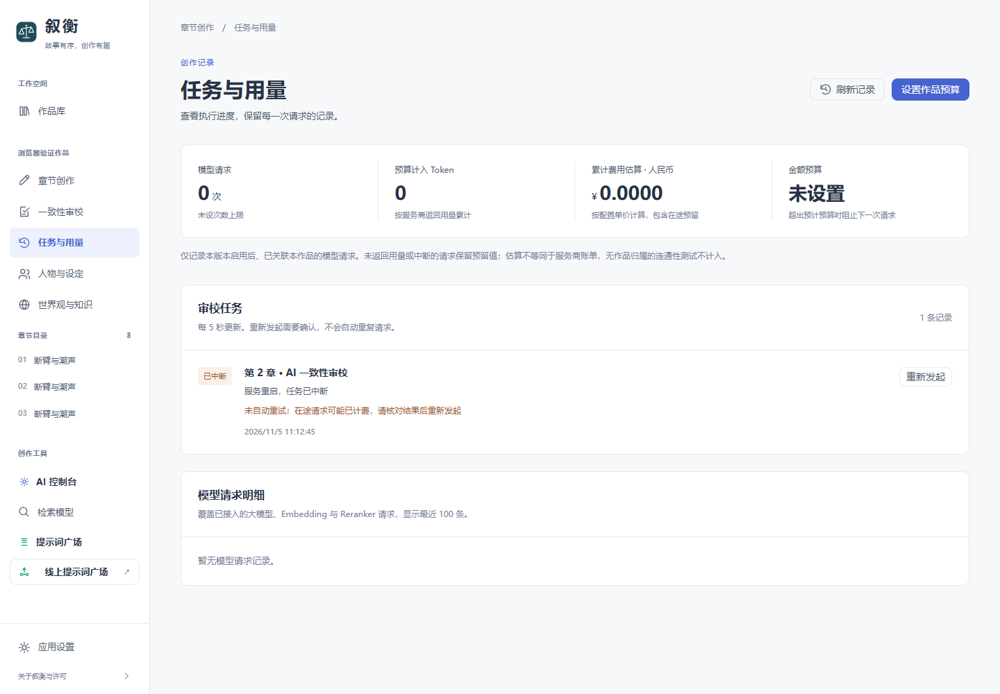

# 叙衡 0.5.0 · 任务、预算与恢复

日期：2026-11-05。

界面截图使用隔离的浏览器测试作品和模拟中断任务，不代表真实模型运行记录。

## 本轮实现

- 新增“任务与用量”页面：作品累计请求、Token、费用估算、任务进度、执行心跳、失败原因、取消、结果跳转与显式重新发起；支持窄屏。
- 审校任务和请求参数摘要写入独立运行记录库。重启后识别中断；结果落库与任务回写之间发生中断时，可按稳定任务 ID 恢复结果关联。重新发起保留原记录、校验正文快照、隔离作品，并对重复提交保持幂等。
- 大模型、Embedding、Reranker 的已接入作品请求在发送前原子检查与预留预算。支持累计请求数、Token 和人民币估算金额上限；输入/输出单价由用户填写并按请求保留快照。并发请求共用同一预留事务。
- 用量缺失、错误和取消不按零消费处理；失败请求保留预留。金额未知时明确标记，开启金额上限需要补齐对应模型单价；补填单价可保守覆盖未定价历史。
- 当前 OpenAI 兼容受管理调用关闭 SDK 隐式重试和内部二次请求回退。高层显式新调用会重新检查预算。托管覆盖各阶段作品作用域，预算拒绝后保存停止状态及原因，手动恢复时保留所在阶段。
- 人物覆盖率以数据库已保存正文为准，使用当前内容与章节号，忽略旧导出文件、空正文、删除章节和其他作品；Bible 提及与引号候选也使用同一正文来源。
- 浏览器测试统一使用 8011 隔离服务，避免规则测试依赖用户正在运行的 8005 服务。

## 验证

最终全量单元测试 1661 项通过、7 项跳过；10 项浏览器场景通过，最后又复核 3 项任务与预算场景。前端类型检查与生产构建通过。测试涵盖原子并发预留、未知用量、价格快照、补填历史单价、跨书隔离、重启恢复、结果关联、取消、重复重试、正文变更拒绝、实际 SDK 传输及预算拦截。

本地实际作品只读检查：运行记录与覆盖率接口均成功，数据库正文共 12 章参与核对，3 个关系图内人物在正文中出现；任务页和预算入口无脚本异常或失败请求。新账本从本版本开始记录，未将旧调用伪装成完整历史用量。

离线受控两章管线：使用真实管线定位、生成步骤和 SQLite 章节保存，HTTP 测试服务在第二次请求返回 429；显式重建执行对象后第二章保存成功，第一章未被覆盖，后续请求在发送前被预算拦截。

真实受控两章管线：本地已激活的 `deepseek-flash`，第一章 419 字、第二章 486 字，均保存为 completed；合计输入 415、输出 681 Token。第三章在请求前被预算阻止，另一作品用量保持 0。未配置费用单价，因此本次人民币金额未知，不能将金额小计 0 解释为免费。

上述管线检查预置章节规划和上下文，关闭额外章后 AI 调用；不等同于完整驾驶舱从规划到所有章后步骤的多章无人值守测试。真实内容仅存在独立验证数据库，未修改用户作品。

## 交付边界

- 任务恢复采取明确中断、检查已保存结果、用户确认后重新发起；不自动重放可能已经计费的在途请求。
- 运行记录库是主数据库旁的 `.operations.sqlite3`，需要共同备份；只支持单个本地 API 进程管理审校任务。
- 用量按接入路径记录，未接入或无作品归属的调用不计入。纯文本流式接口可能没有真实 Token，保守使用请求预留；价格估算不替代账单。
- 长时间无人值守、完整规划和章后链路的连续多章、真实长篇人工质量评测、大规模检索、独立安装包与公网多用户仍在路线图中。

来源与许可继续保留在仓库声明及许可证中。
