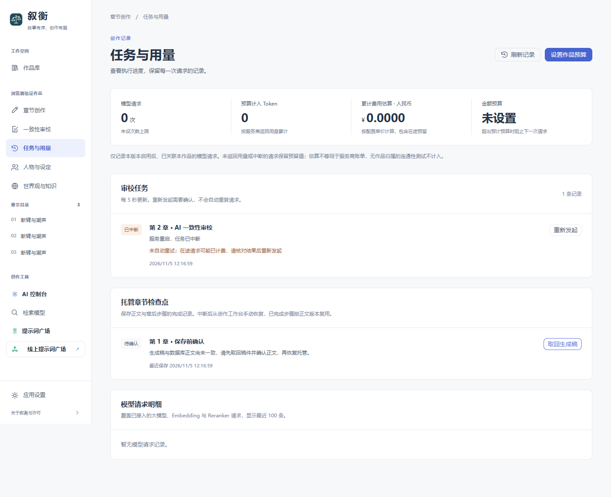

# 叙衡 0.6.0 · 章节保存与托管恢复

日期：2026-11-05。

截图为隔离的浏览器测试作品，生成稿与中断记录均为测试数据。

## 改动

- 增加按作品、章节和正文哈希隔离的持久化检查点。生成稿先在运行记录库留存，再写正文；只有从章节仓库读回完全一致的已完成正文，才确认保存成功。
- 保存失败或无法确认时停止托管，保留生成稿。“任务与用量 → 托管章节检查点”可以下载对应版本的 Markdown 稿件，不覆盖当前正文；正文变更与尚未落库的稿件分别显示。
- 稿件已保存、章后尚未完成时，恢复优先进入审计。覆盖提交后但检查点回写前退出、章节计数尚未更新、旧版审计请求待处理等情况；保护章数依据数据库正文重新核对。
- 文风结果、审计报告、章后提取报告及成功返回的章后结果按正文版本持久化复用。恢复时不重新请求已确认完成的对应步骤；修改正文或切换作品不复用旧版本结果。
- 叙事摘要提取失败不再写入空摘要、误报同步成功或继续调用可选分析。正文保留，托管停止，明确等待修复模型或网络后手动恢复。
- 宏观规划、幕级规划、正文与审计请求失败或被阻塞时，停止托管；需要人工审核的正常等待状态继续保留。已完成的每章审阅在显式恢复后前进，避免反复进入同一审阅节点。
- 共同关系查询直接读取邻居 ID，避免为每条边构造不需要的关系元组；保留原性能测试门限。

## 验证

全量单元测试 1700 项通过、7 项跳过；11 项浏览器场景通过，前端类型检查及生产构建通过。生成稿下载场景另行复核一次；本地现有作品页面与接口只读检查通过，无脚本异常或失败请求，待审阅状态保留。

新增验证包括：

- 子进程在真实 SQLite 正文提交后强制退出，父进程重开数据库，正文仍在且恢复选择审计。
- 管线保存前、保存后、章后处理后的故障注入；未写入的正文不误判已保存，已写入的正文不重新生成。
- 三章经过实际写作委托、章节仓库、审计委托与检查点流程；第二章审计前清空内存对象，仍复用已保存的章后结果，第三章完成后停止。
- 审计报告完成后发生断网，重建执行对象后只继续未完成步骤；章后同步失败、恢复、正文修改、跨书隔离及每章审阅后前进。
- 主库写入暂不生效时保留生成稿并停止；延迟写入随后成功时，恢复到审计而非再次生成。
- 生成稿导出的作品边界、哈希校验、当前正文不被覆盖，以及接口不直接泄露稿件全文到状态响应。

三章场景的规划和模型调用使用明确的测试替身，非真实模型长跑。本轮新增的可靠性测试未调用付费模型；真实模型结果仍以前一版的受控联调为准。

## 使用

保存当前编辑内容后刷新本地页面。打开“更多工具 → 任务与用量”，检查“托管章节检查点”。

“待恢复”表示正文已保存、后续步骤未完成；修复配置或网络后，从创作工作台手动恢复托管。“待确认”表示生成稿与主库正文尚未一致；先下载生成稿、确认当前正文，再决定是否恢复。取回操作只下载文件，不修改作品。

旧作品此前没有检查点的章节不会被批量重新生成或补做审计；旧版中断的审计请求仍可按其会话类型恢复。恢复只复用正文版本匹配的步骤，并不重新评估模型结论的文学或事实质量。

主库和 `.operations.sqlite3` 继续需要共同备份。运行记录库会保存生成稿版本；跨库不是全局事务，辅助后台任务的完整幂等与断电恢复仍需专项验证。当前仍按单个本地 API 进程使用。

完整规划及全部章后模型调用的长时间无人值守、真实长篇人工评测、大规模检索、安装包与公网服务仍在路线图中。
