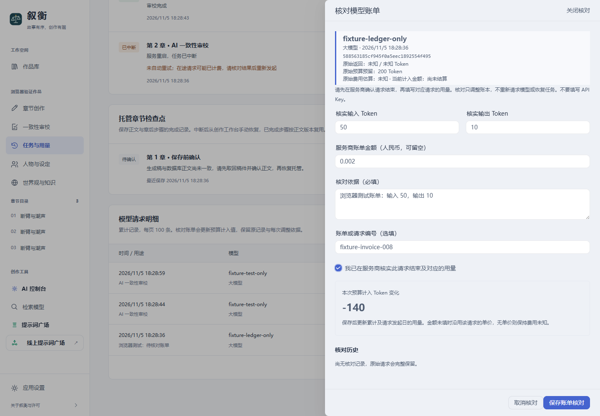

# 叙衡 0.8.0 · 每日预算与账单核对

日期：2026-11-05。本批联合交付 F10、F11 两个模块。

截图中的模型名、账单与用量均为浏览器测试数据。

## 本批功能

| 进度项 | 交付内容 |
| --- | --- |
| F10 · 按日预算与费用汇总 | 同时检查累计及每日请求数、Token、费用上限；IANA 时区划分每日窗口；按日期、模型和服务类型汇总；按请求发起日结算，跨日完成仍归属原日 |
| F11 · 未知用量确认与账单核对 | 人工填写服务商确认的 Token、金额、依据及编号；原始请求保留，核对追加新版本；展示前后差额，更新累计/每日预算计入值；旧窗口冲突保护与重复提交去重 |

“任务与用量”页面新增每日账目和账单核对抽屉。请求明细每页 100 条，可翻页查看旧记录或筛选待核对记录；统计始终基于全部匹配请求，不因分页而缩小。

每日时区默认 `Asia/Shanghai`，支持 `UTC` 等 IANA 时区，补充 `tzdata` 依赖以支持 Windows。当地零点重置每日额度，累计限额继续生效；预算拦截附有失效时间，停止的任务需要手动恢复。修改时区重新划分每日账目，不清空累计历史。查询旧日期时，限额展示为当前设置，不代表当时的历史限额。

## 数据与核对规则

- 原请求保存在 `calls`，不因核对改写。`call_adjustments` 记录每版核对的前后快照、依据、编号、时间和差额；有效账本视图取最新版本。原请求后来返回用量时仍保留该返回值，已确认的人工核对不被悄悄覆盖。
- 输入与输出 Token 必须是非负整数，服务商明确确认的零有效；金额必须是有效非负数。金额留空按该请求保存的单价估算，无单价保持未知；后补缺失单价可以补齐估算，历史核对快照不被改写。
- 核对前需确认服务商请求已经结束；本地作品仍在托管、生成或审校时，拒绝核对在途请求。操作只调整账本，不重新发送模型请求、不恢复任务、不将失败正文标为完整。
- 提交标识去重，版本号防止旧窗口覆盖新核对；同一标识用于不同内容会冲突。核对与预算预留使用独立 SQLite 的写事务，累计、每日、模型汇总和下一次预算检查读取同一有效账本。
- 原数据库采用增量升级，不删除已有表；升级前保留了本机主库与运行记录库的维护备份并检查完整性。该一次性维护备份不是 F03 联合备份恢复产品功能。

## 联合验证

**1762 项单元测试通过、7 项跳过；13 项浏览器场景通过；前端类型检查和生产构建通过。**

本批新增 35 项后端专项测试，见 [test_daily_billing.py](../tests/unit/application/audit/test_daily_billing.py)：

- 上海时区跨日、UTC 重分组、夏令时的 23/25 小时日期边界、非法日期和时区。
- 每日和累计限额同时生效、每日请求数并发原子预留、未知用量及金额不按零放行、发起日归属与跨日返回。
- 费用按模型和服务类型汇总；旧未知记录的分页/筛选与全部账目统计。
- 真实 SQLite 中保存核对、重开恢复、原记录保留、明确零账单、缺失金额、后补价格和请求单价快照。
- 多版修正、重复提交、重试提交时有新任务启动、旧版本冲突、并发核对与跨书访问拒绝。
- 旧格式账本升级、同一进程多线程初始化与默认配置不串书。
- 实际 OpenAI SDK 配合模拟 HTTP/SSE：第一次正常流未返回用量，保留预留；第二次在发送前被每日上限拦截；核对后第三次重新检查预算并成功。物理 HTTP 请求总数为 2，最终日报与累计均计入 32 Token，没有隐式重试。

浏览器在隔离作品中完成“设每日零额度 → 审校被拦截 → 不增加模型请求”“填写账单与依据 → 预览 -140 Token → 保存 → 累计/每日同步变化 → 刷新后核对历史仍在”，并检查桌面、390px 窄屏及其余编辑、审校、关系图、检查点与辅助面板。

本轮没有调用真实付费模型或访问服务商账单；服务商用量的真实返回仍以前版 DeepSeek 流式联调为依据。本地实际作品另做只读页面及接口检查，不注入测试账单、不修改用户正文、不启动托管生成。交付包解压后另做启动、离线审校及无密钥检查。

## 使用与后续

刷新页面，打开“更多工具 → 任务与用量”。设置每日上限后保存；从明细打开“核对账单”，按服务商对应请求的明细填写，保留可追溯的核对依据，不填写密钥。

核对是使用者确认后的账本调整，不会自动登录服务商核验；金额按人民币记录，不处理汇率、发票自动导入或服务商阶梯计价。当前仍按单个本地 API 进程使用；完整多进程任务协调属于 F15。

F02 章后辅助任务持久化与幂等、F03 联合备份恢复、F01 完整真实模型多章长跑仍保持未完成，按进度表后续验收。
