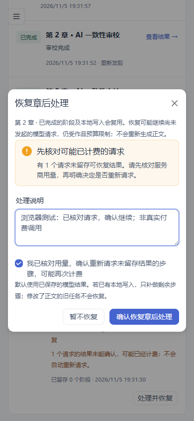

# 叙衡 0.9.0 · 章后任务恢复与幂等

日期：2026-11-05。优先交付 P0 项 **F02**，解决章后内存队列重启丢失、完成状态不可靠和重复执行问题。

截图为隔离测试作品，模型结果与确认说明均为测试数据。

## 实现

- 保存、托管收稿和旧版章后提取入口共用持久化任务，以作品、章节、正文哈希去重。HTTP 保存会先确认正文和任务记录，再开始后台分析。
- 主库留存任务、阶段结果、模型请求输出及恢复处理记录。原分析模型结果在交给业务解析前保存，恢复默认复用；按业务调用角色区分结果，避免可选分支变化时串用输出。
- 图谱、伏笔、债务、人物状态、道具事件、治理报告和辅助快照等已标记本地步骤，与完成标记放在同一主库事务提交。子仓储加入该事务，嵌套提交不能提前落库，写入失败会回滚；本地事务禁止远端模型或检索请求。
- 核心分析完成后持久化排队辅助尾部，API 启动扫描继续处理。运行中任务有心跳和领取保护；失去心跳 45 秒后，已有可恢复结果的继续排队，未确认请求进入等待确认。
- 未确认计费请求不自动重新发起。用户需核对服务商用量、填写说明并明确确认；旧预留仍保留在账本中，是否调整由账单核对处理。只补做缺失部分，不把确认缺失请求当作重做全部分析的授权。
- 模型格式错误时保留原输出；明确选择重新请求，才对尚无本地写入的未完成阶段追加尝试。原输出、计费记录和处理依据保留。
- 正文变化、章节删除、预算拦截、写入失败或取消不会误报任务完成。取消信号继续传递给执行器；当前远端请求可能已被服务商计费。
- “任务与用量”新增章后处理任务、完成阶段计数、错误提示、处理并恢复入口和恢复处理记录。

## 验证

**1782 项单元测试通过、7 项跳过；14 项浏览器场景通过；前端类型检查及生产构建通过。**

新增 20 项专项测试位于 [test_durable_aftermath.py](../tests/unit/engine/test_durable_aftermath.py)，验证：

- 子进程在本地写入提交前强制退出，数据与完成标记一起回滚；提交后强制退出，重开数据库后跳过已提交步骤，不重复写入。
- 子进程保存模型响应后、业务投影前退出，父进程恢复时直接使用留存响应，不再调用模型。
- 真实图谱、伏笔及债务仓储重复恢复后记录数不增加，已经结清的债务不被重新打开。
- 实际 `ChapterAftermathPipeline` 的摘要、张力、知识落库、图谱、护栏、治理和世界线辅助流程；再次进入不新增快照或模型请求。此场景的模型与护栏评分使用测试替身。
- 成功的第一次模型结果在第二次请求中断后仍复用；未知请求需明确确认，预算拒绝不记为已发送请求，取消不被错误吞掉。
- Embedding 中断后留存已有叙事与图谱，确认后只继续缺失索引处理；原失败请求预留不自动释放。
- 条件分支变化不串用其他操作的模型输出；解析失败不生成完成标记；被旧代码捕获的 SQL 写入失败仍回滚。
- 活跃心跳不被恢复扫描抢占、跨书访问拒绝、正文修改/删除阻止旧写入、恢复重复提交不额外执行。

浏览器完成“看到需要确认 → 未确认/未填写说明不能恢复 → 提交明确决定 → 后台继续 → 完成 → 重复提交不增加模型请求”，检查手机和桌面布局，原有编辑、图谱、审校、预算、账单核对及检查点场景一并通过。

本轮使用隔离数据库、模拟分析模型及强制退出子进程，没有调用真实付费模型。真实作品仅做只读检查，不补跑旧章节，不注入测试任务或账单。升级前保留主库和运行记录库的维护备份；交付包另行解压验证启动、离线审校及无密钥状态。

## 使用与边界

刷新后打开“更多工具 → 任务与用量 → 章后处理任务”。正常排队任务由 API 服务恢复；需要确认或失败的任务点击“处理并恢复”。恢复可能执行原先尚未开始的分析请求，继续受作品预算限制，不自动启动整本小说的托管写作。

主库新增 `xh_aftermath_*`，账本仍在 `.operations.sqlite3`；两者必须一起备份。恢复扫描由浏览器版 API 服务负责，单独启动旧 CLI 不代替该服务。已完成任务冻结本次正文版本的结果，修改预算或模型档案不会自动重做成功步骤。正文变更后的知识撤销、事实冲突及后续历史重建属于 F06/F08 范围。

本版本不宣称完整长篇无人值守已经验收，不提供跨库全局事务或全部执行进程的统一协调。**F03 联合备份恢复、F01 真实模型完整多章验收**仍保持未完成，作为后续 P0 项推进。
